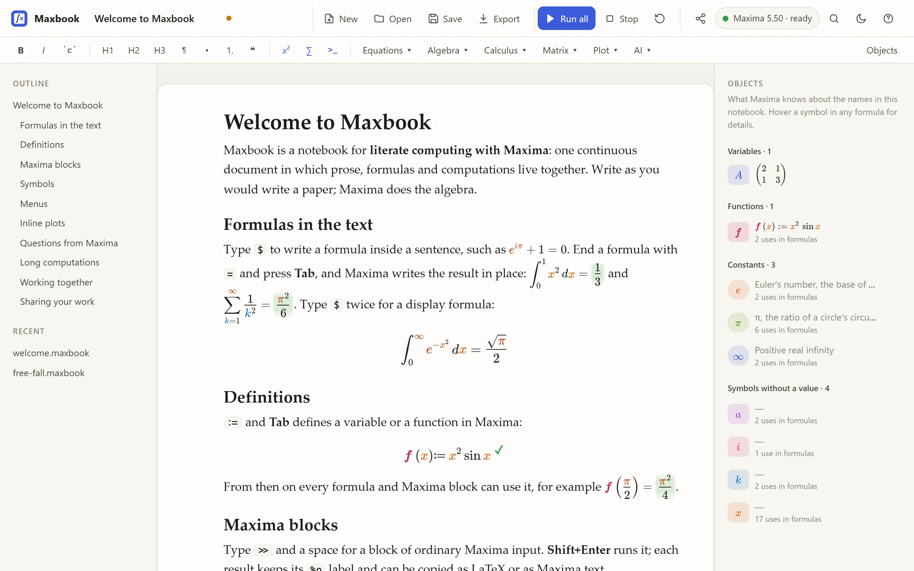

# Maxbook

Maxbook is a notebook for literate computing with the [Maxima](https://maxima.sourceforge.io/) computer algebra system: prose, formulas and live computations in one continuous document. It is meant as a modern alternative to wxMaxima and TeXmacs for writing mathematics that is computed by Maxima.

**[Documentation, tutorials and screenshots](https://foadsf.github.io/maxbook/)** · **[Download](https://github.com/Foadsf/maxbook/releases/latest)** for Windows, macOS and Linux



Status: **0.5.0, alpha.** Used and tested by hand on Windows with Maxima 5.50; the automated tests also run on Linux against Maxima 5.46. macOS is untested (see [Limitations](#limitations)).

## What it does

- **One continuous document.** Write as in a word processor: headings, lists, quotes, bold, code. Type `$` for a formula inside a sentence, `$` again in an empty formula for a display formula, and `>>` plus a space for a block of Maxima input. Markdown typed or pasted is converted as you go, and so is pasted LaTeX (sections, inline and display math).
- **Compute in place.** End a formula with `=` and press **Tab**: Maxima's result appears right after it (noun forms such as integrals and sums are evaluated). End it with `:=` (for example `f(x) := x^2 \sin x`) and Tab defines it in Maxima. The Maxima translation of a display formula is shown under it while you edit, so nothing is evaluated that you cannot see.
- **Real Maxima.** Maxima blocks hold ordinary Maxima input with syntax highlighting. Results come back as typeset math with their `%o` labels; `%`, labels and definitions carry across the document as in a Maxima session. Copy any result as LaTeX or as Maxima text.
- **Symbols that know what they are.** Every name has its own colour in formulas and results, and constants such as π and e are marked. Hover a symbol to see whether it is a variable, function or constant and its current value. The **Objects** panel lists the notebook's variables, functions, constants and free symbols; click one to highlight every use, or add a description, which is saved in the notebook.
- **Menus like wxMaxima.** Equations, Algebra, Calculus, Matrix and Plot menus open short forms (solve, integrate, Taylor series, eigenvalues, plots, …) that write the Maxima code for you; Ctrl+K searches every command, form and formula template.
- **Stop keeps your work.** Stop interrupts the running computation inside Maxima, which keeps everything defined so far. Restart starts a fresh Maxima.
- **Questions.** When Maxima asks something ("Is a positive, negative or zero?") the question appears in the document with quick-answer buttons.
- **Inline plots.** `iplot2d`, `iplot3d`, `idraw2d`, `idraw3d`, `idraw` take the arguments of `plot2d`, `plot3d`, `draw2d`, … and draw into the document as SVG. `wxplot2d` and friends are aliases, so wxMaxima worksheets run unchanged.
- **Edit together.** Several windows on one computer stay in sync. With `--share`, people on your network can open the notebook from a link and edit it with you; only you run Maxima, open and save files.
- **AI helper (optional, off by default).** Explain a selection, show steps, simplify and check, write Maxima code, answer a question about the notebook, or transcribe a photo of handwritten math into the document. See [AI helper](#ai-helper) for what is sent where.
- **Files.** Notebooks are `.maxbook` (plain JSON, outputs included, diff-friendly; files from 0.1 open and are converted). Opens wxMaxima `.wxm` and `.wxmx`, Maxima batch `.mac`, Markdown with ```` ```maxima ```` blocks and LaTeX `.tex`. Exports LaTeX with PNG figures (compiles with pdflatex), a self-contained offline HTML page, Markdown, `.mac`, `.wxm` and `.wxmx` (which wxMaxima opens and recomputes).

## Install and run

The easiest way: install [Maxima](https://maxima.sourceforge.io/download.html), then download the single-file program for your computer from the [latest release](https://github.com/Foadsf/maxbook/releases/latest) and run it. Step-by-step instructions for each system are in the [install guide](https://foadsf.github.io/maxbook/install/).

To run from source instead you need Python 3.9+ and Maxima (any recent version; tested with 5.50 on Windows). No Python packages are required.

```bash
git clone https://github.com/Foadsf/maxbook
cd maxbook
python -m maxbook examples/welcome.maxbook
```

Or install the `maxbook` command, which works from any folder:

```bash
pip install -e .
maxbook notebook.maxbook
```

Naming a file that does not exist yet starts a new notebook that saves there.

The UI opens in a native window when [pywebview](https://pywebview.flowrl.com/) is installed (`pip install -e .[desktop]`), otherwise in a Chromium-based browser in app mode (Edge, Chrome, Brave, Chromium), otherwise in the default browser.

Options: `--maxima PATH` (or environment variable `MAXBOOK_MAXIMA`) when Maxima is not found automatically; `--window none` to only print the URL; `--port N`; `--share` to edit together over the network.

Maxima is found in this order: `--maxima`, `MAXBOOK_MAXIMA`, the usual install folders on Windows (Scoop, `C:\maxima-*`, Program Files) and macOS, then `maxima` on `PATH`.

## Keyboard

| Keys | Action |
|---|---|
| `$` | Formula in the text; `$` again in an empty formula makes it a display formula |
| `=` then Tab | Compute in place |
| `:=` then Tab | Define a variable or function in Maxima |
| `>>` and space, or Ctrl+Alt+M | Maxima block (also ```` ``` ```` and space) |
| Shift+Enter | Run a Maxima block or evaluate a display formula, then move on |
| Alt+Enter | Run and insert a new Maxima block below |
| Ctrl+Shift+Enter | Run everything in document order |
| `#`, `##`, `###` and space | Headings; `-` or `1.` lists; `>` quote; `---` rule |
| A word in a formula (`int`, `frac`, `sum`, `lim`, `matrix`, …) | Insert that structure (Enter or Tab) |
| Ctrl+M, Ctrl+Shift+M | Inline formula, display formula |
| Ctrl+K | Search commands, forms and templates |
| Ctrl+S, Ctrl+Shift+S, Ctrl+O | Save, Save as, Open/import |
| F1 | Shortcut overview |

## Editing together

```bash
maxbook --share notebook.maxbook
```

Maxbook then also listens on your network and prints links such as `http://192.168.1.20:51234/#token=…`. Anyone who opens one can read and edit the notebook in real time; they see who else is there. Guests cannot run Maxima, open, save or export files, or use the AI helper, because a Maxima session can run shell commands on your computer. Share the link only with people you trust, on a network you trust: the connection is plain HTTP. Without `--share`, Maxbook listens on `127.0.0.1` only.

## AI helper

The AI helper is optional. It uses Anthropic's Claude through the official `anthropic` Python package and is enabled only when that package is installed and credentials are configured:

```bash
pip install -e .[ai]
```

Credentials are read the way the Anthropic SDK reads them: `ANTHROPIC_API_KEY`, `ANTHROPIC_AUTH_TOKEN`, or a profile from `ant auth login` (then set `MAXBOOK_AI=1`). `MAXBOOK_AI=0` turns the helper off; `MAXBOOK_AI_MODEL` picks another model (default `claude-opus-5-5`). The key stays in the Maxbook server process and is never sent to the browser.

**Privacy:** using the helper sends the selected text and formulas together with the notebook's Maxima input (up to its last 6000 characters; for transcription, only the image) to Anthropic's API. Maxbook asks before the first use in each browser. Nothing is sent unless you choose an AI command. Answers are inserted into the document as ordinary, editable content; check them like any other source.

## How it works

A small Python server (standard library only) runs one Maxima process and serves the web UI. A Lisp file loaded into Maxima at start-up frames every result, question, prompt and image so the server can parse them reliably, tags every symbol in results with its kind, and reports the session's symbol table; statements are sent one at a time. The editor is [ProseMirror](https://prosemirror.net/) with [MathLive](https://cortexjs.io/mathlive/) formula fields; collaboration uses ProseMirror's step protocol with the server as the authority. Details in [Architecture](https://foadsf.github.io/maxbook/development/architecture/). The formula translation rules are in [Formula syntax](https://foadsf.github.io/maxbook/reference/formula-syntax/).

Security: every API call needs a per-launch secret plus a matching `Host` header, because a Maxima session can run shell commands. The host's secret is accepted only from the same computer.

## Limitations

- **Platforms.** The full UI was tested by hand on Windows 11 (Maxima 5.50 with SBCL, Python 3.13, Edge and the built-in Chromium). On Linux the automated tests, including the real-Maxima ones, pass in CI (Ubuntu 24.04, Maxima 5.46, Python 3.9 and 3.12), but the desktop window has not been tried there. macOS is untested.
- **Stop needs an interruptible Maxima.** In-place Stop uses Maxima's signal thread and `winkill` on Windows, and SIGINT elsewhere. If the computation does not stop within a few seconds, Maxima is restarted and definitions are lost; the block says which happened.
- **One Maxima session per running Maxbook**, shared by whatever notebook is open. Opening another notebook does not reset Maxima; use Restart.
- **Formulas cover a documented subset** of notation (see [Formula syntax](https://foadsf.github.io/maxbook/reference/formula-syntax/)). Anything else is reported as an error with a hint, never guessed.
- **The Objects panel** lists Maxima's names that the notebook's own code mentions; names defined by loaded packages are left out.
- **Collaboration is for a trusted local network.** No accounts, no encryption, no history beyond undo; the shared document lives in the running Maxbook until it is saved.
- **The AI helper was tested against a simulated API only**, since no key was available during development; its requests follow the SDK documentation.
- LaTeX export rasterises plots to PNG; HTML and Markdown keep them as SVG. Characters pdfLaTeX has no glyph for are shown as `[U+XXXX]` (XeLaTeX and LuaLaTeX print them).
- Large outputs are not truncated or line-broken yet.

## Development

```bash
python -m pytest
ruff check maxbook tests
```

`tests/test_kernel.py` drives a real Maxima and is skipped when Maxima is not installed; `tests/test_formats.py` compiles the LaTeX export when `pdflatex` is available (or set `MAXBOOK_PDFLATEX`); `tests/test_ai_collab.py` runs the AI helper against a fake client and the collaboration hub. CI runs all of them on Linux; on Windows it runs those that need neither Maxima nor pdflatex. Front-end behaviour was checked by hand in a browser; there are no automated browser tests yet.

The ProseMirror bundle is committed, so no Node.js is needed to run or package Maxbook. To change it: `cd tools/vendor && npm ci && node build.mjs`.

Third-party code is listed in [THIRD_PARTY_NOTICES.md](THIRD_PARTY_NOTICES.md). Contributions are welcome; please run the tests and `ruff` before opening a pull request.

## Licence

Copyright (C) 2026 Foad S. Farimani.

Maxbook is free software: you can redistribute it and/or modify it under the terms of the GNU General Public License as published by the Free Software Foundation, either version 3 of the License, or (at your option) any later version. It is distributed in the hope that it will be useful, but WITHOUT ANY WARRANTY; see [LICENSE](LICENSE) for details.

Maxbook is an independent project and is not affiliated with or endorsed by any other notebook or math-editor product. It talks to Maxima as a separate program.
